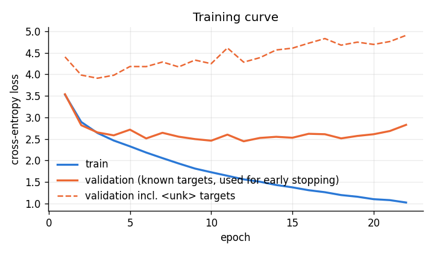
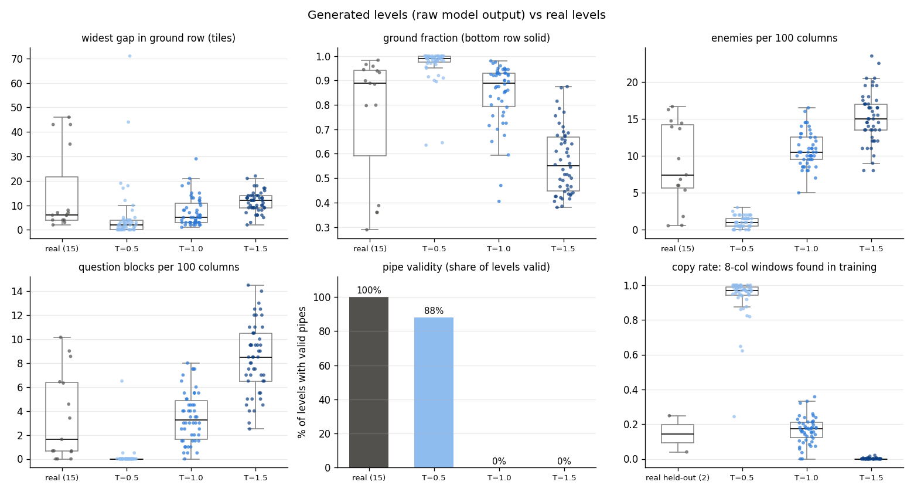
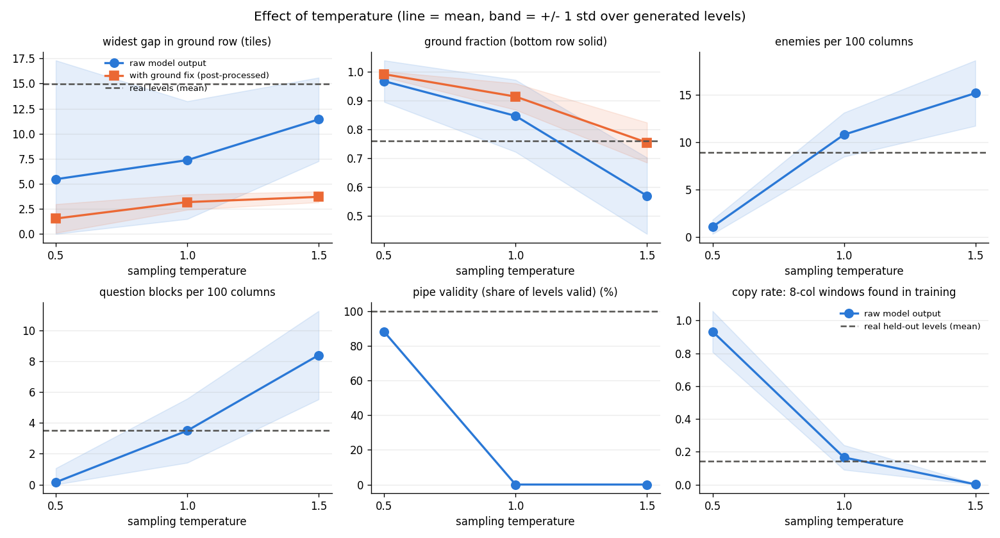
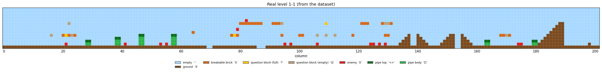
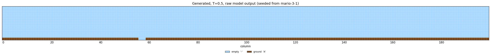
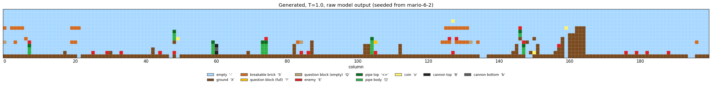
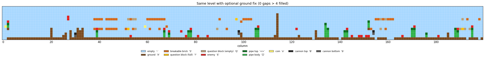
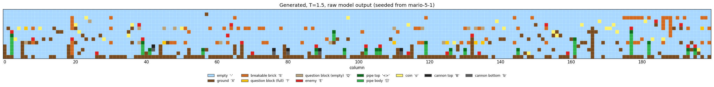
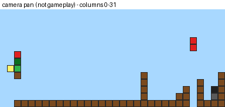

# lstm-mario-level-generator

An LSTM that writes new **Super Mario Bros level layouts** one column of tiles at a time, plus tools to draw them, and an honest evaluation against the real levels.


> **What this is not.** The model only outputs a grid of tile characters (text). The images and GIF are drawn from that grid afterwards. There is no game engine and no gameplay video, and the model knows nothing about jumping. **None of the generated levels are claimed to be playable.**

---

## What it is

1. Download 15 real SMB levels from the Video Game Level Corpus (text grids, 14 rows tall).
2. Cut each level into **columns**. Each 14-character column is one token.
3. Train an LSTM to predict the next column from the previous 16.
4. Generate new levels by repeatedly sampling the next column.
5. Render them as PNG images and a *camera-pan* GIF.
6. Measure them against real levels: gaps, ground, enemies, question blocks, pipe validity, and how much they copy.

## How an LSTM generates sequences

**Next-element prediction.** During training the model sees 16 consecutive columns and has to output a probability for every possible next column. Cross-entropy loss pushes up the probability of the column that really came next. An LSTM reads the 16 columns in order and keeps a memory vector (the hidden and cell state), so its prediction can depend on, for example, "a pipe started 1 column ago".

**Sampling.** To generate, we start from 16 real columns (the *seed*), ask the model for the next-column distribution, **draw** one column at random from it, append it, slide the window one step right, and repeat 200 times. Sampling instead of always taking the most likely column is what makes each level different.

**Temperature.** Before the softmax, the logits are divided by a temperature *T*:

```
p_i = softmax(logits / T)_i
```

* *T* < 1 sharpens the distribution: safer, more repetitive output that copies more from the training data.
* *T* = 1 uses the model's own distribution.
* *T* > 1 flattens it: more surprising, and more broken.

**Top-k** (optional, `generate.top_k`) keeps only the *k* most likely columns before sampling. The `<unk>` token is never sampled.

In the notebook, for one real window, the probability of the top column was **0.985 at T=0.5, 0.699 at T=1.0 and 0.34 at T=1.5**.

## Data and credit

Levels come from **The Video Game Level Corpus (VGLC)** by **Adam Summerville, Sam Snodgrass, Michael Mateas and Santiago Ontañón**: <https://github.com/TheVGLC/TheVGLC>, folder `Super Mario Bros/Processed`. The download script pins commit `0e86a8f31f20ecad4eaa5741ff061af88767f7fb`.

* **Licence.** The corpus `License.md` is the **MIT License, Copyright (c) 2016 Adam Summerville, Santiago Ontanon, Sam Snodgrass**. It allows reuse, provided the copyright and permission notice is kept with copies or substantial portions. This repository therefore **does not commit the data**. `scripts/download_data.py` fetches it (including `License.md`) into `data/`, which is git-ignored. If you redistribute the data, keep that licence file with it.
* The level layouts themselves come from Nintendo's *Super Mario Bros.* This is a non-commercial learning project. No game graphics are used: tiles are drawn as plain coloured squares.
* Paper: Summerville et al., *The VGLC: The Video Game Level Corpus*, 2016 (see References).

**Checks done in code** (`src/data.py`):

| check | result on the pinned data |
|---|---|
| every file has 14 rows | **yes, all 15 files** (widths 149–373 columns, 1-1 is 14 × 202) |
| what happens if not | `data.row_mismatch: pad` (default) adds empty sky rows on top, or crops from the top, and prints a warning. `skip` drops the file with a warning. **Neither was triggered.** |
| legend | read from `Super Mario Bros/smb.json`. Note: the file sits **one folder above** `Processed/`, not inside it. |
| unknown characters | a character not in the legend raises `ValueError` with file, row and column. None found. |
| rows of equal width | checked, otherwise `ValueError` |

Legend: `X` ground · `S` breakable brick · `-` empty · `?` full question block · `Q` empty question block · `E` enemy · `<` `>` pipe top-left/right · `[` `]` pipe left/right · `o` coin · `B` cannon top · `b` cannon bottom.

### Why column tokens?

A column is the natural unit of a side-scroller: the screen scrolls one column at a time, and a column already encodes vertical structure (a pipe body sitting on ground, a block floating above). Using whole columns means the model **cannot** produce an impossible vertical stack inside a column it has seen. The cost is that it can only reuse columns that exist in the training data. The vocabulary is small: **271 distinct columns in all 15 levels, 218 in the 13 training levels, plus `<unk>` = 219 tokens.** Columns that appear only in the held-out levels map to `<unk>`. That is **75 of the 342 validation columns (22%)**, mostly because 1-2 is an underground level with a brick ceiling. This simple design follows Summerville & Mateas (2016), who also generate SMB levels with LSTMs (they used a character-level encoding with extra path information; this project deliberately keeps it simpler).

## Setup

Python 3.10+ (tested on Python 3.12.4, PyTorch 2.13.0 CPU, Windows 11).

```bash
python -m venv .venv
# Windows: .venv\Scripts\activate     macOS/Linux: source .venv/bin/activate
pip install -r requirements.txt
python scripts/download_data.py
python -m pytest -q
```

A GPU is used automatically if `torch.cuda.is_available()`. Everything below ran on CPU.

The trained model from the run reported below is included as `checkpoints/best.pt` (3.7 MB), so `python -m src.generate`, `python -m src.evaluate` and `python -m src.app` work right after setup. Running `python -m src.train` overwrites it.

## How to run

All settings are in [`config.yaml`](config.yaml). Override any of them with `--set section.key=value` (repeatable).

```bash
# train (early stopping, best checkpoint -> checkpoints/best.pt, curve -> outputs/train_curve.png)
python -m src.train
python -m src.train --set train.max_epochs=5            # quick smoke run

# generate 3 levels at T=1.0 -> outputs/generated/*.txt, *.png, *_camera_pan.gif
python -m src.generate
python -m src.generate --set generate.temperature=0.7 --set generate.top_k=10
python -m src.generate --set generate.fix_ground=true    # OPTIONAL post-processing (labelled in file names)

# evaluate: 50 levels x T in {0.5, 1.0, 1.5}, raw and with ground fix -> outputs/eval/
python -m src.evaluate

# draw any level text file
python -m src.render outputs/generated/level_T1p0_k0_00.txt

# local web app: generate levels in the browser -> open http://localhost:8000 (Ctrl+C to stop)
python -m src.app
```

The web app (`src/app.py` + `src/static/index.html`) only uses Python's built-in HTTP server and listens on 127.0.0.1, so only your own computer can open it. It loads the trained checkpoint once. Every *Generate* click runs the same sampling loop as `src.generate` and shows the level, the 16 real seed columns (greyed, left of the line), the metrics next to the real-level averages, and the raw text. The *Evaluation results* tab shows the charts from `outputs/eval/`.

Notebook walkthrough: [`notebooks/walkthrough.ipynb`](notebooks/walkthrough.ipynb). Run it after training.

### Model and training details

| | |
|---|---|
| input | 16 column ids (`train.window`) |
| model | Embedding(219, 64) → LSTM(64→256) → LSTM(256→256), dropout 0.3 between and after → Linear(256→219) — 926,363 parameters |
| loss / optimiser | cross-entropy / Adam, lr 0.001, batch 64, gradient clipping 1.0 |
| split | **by level**, 2 levels held out with seed 42: **mario-1-2, mario-6-1**. Windows never cross a level boundary, so overlapping windows cannot leak. |
| samples | 2,373 training windows, 310 validation windows |
| early stopping | patience 10 on validation loss **over targets that are in the vocabulary** (see below) |
| seeds | `seed: 42` for Python, NumPy, PyTorch, the data split, the shuffling and sampling |

**A design decision I had to make.** My first run used the plain validation loss over all targets. It picked the epoch-3 checkpoint, and that model produced near-random columns. The reason: 75 of the 310 validation targets are `<unk>`, which no model can predict. Their loss grows as the model gets more confident, and it dominates the average. Early stopping now uses the loss on the 235 validation windows whose target is a known column. The all-targets loss is still logged (`val incl. <unk>`, the dashed line in the training curve).

## Results (real numbers from my run)

### Training



* Stopped at epoch 22 (no improvement for 10 epochs). Best checkpoint: **epoch 12**. 106.9 s on a laptop CPU.
* Best validation loss on known targets: **2.446**, accuracy **50.4%**. A baseline that always predicts the most common column gets **32.6%**.
* Validation loss including `<unk>` targets at that epoch: 4.281.
* Training loss kept falling (1.03 at epoch 22) while validation loss stopped improving around epoch 10–12. With 13 levels, the model overfits fast.

### Generated levels (50 per temperature, 200 columns each, top-k off)

Mean ± standard deviation. "+ground fix" is the **optional post-processing** (bottom-row gaps wider than 4 filled with `X`), applied to the *same* 50 levels.

| group | widest gap | ground fraction | enemies /100 col | ? blocks /100 col | pipes valid | copy rate (8-col) | pipe errors |
|---|---|---|---|---|---|---|---|
| real, all 15 | 14.93 ± 16.38 | 0.76 ± 0.25 | 8.92 ± 5.49 | 3.51 ± 3.56 | 100% | 0.89 ± 0.29 | 0.00 |
| real, train (13) | 16.15 ± 17.28 | 0.75 ± 0.27 | 9.18 ± 5.23 | 3.44 ± 3.71 | 100% | 1.00 (by definition) | 0.00 |
| real, held out (1-2, 6-1) | 7.00 ± 0.00 | 0.85 ± 0.05 | 7.23 ± 6.69 | 3.98 ± 2.35 | 100% | **0.14 ± 0.10** | 0.00 |
| T=0.5 raw | 5.46 ± 11.84 | 0.97 ± 0.07 | 1.07 ± 0.76 | 0.15 ± 0.91 | 88% | **0.93 ± 0.13** | 0.84 ± 3.17 |
| T=0.5 +ground fix | 1.54 ± 1.43 | 0.99 ± 0.01 | 1.07 ± 0.76 | 0.15 ± 0.91 | 88% | 0.93 ± 0.13 | 0.84 ± 3.17 |
| T=1.0 raw | 7.36 ± 5.87 | 0.85 ± 0.12 | 10.81 ± 2.33 | 3.50 ± 2.08 | **0%** | 0.17 ± 0.08 | 27.88 ± 17.68 |
| T=1.0 +ground fix | 3.18 ± 0.77 | 0.91 ± 0.05 | 10.81 ± 2.33 | 3.50 ± 2.08 | 0% | 0.17 ± 0.07 | 27.88 ± 17.68 |
| T=1.5 raw | 11.42 ± 4.17 | 0.57 ± 0.13 | 15.20 ± 3.46 | 8.41 ± 2.87 | 0% | 0.00 ± 0.00 | 52.36 ± 15.63 |
| T=1.5 +ground fix | 3.70 ± 0.54 | 0.75 ± 0.07 | 15.20 ± 3.46 | 8.41 ± 2.87 | 0% | 0.00 ± 0.00 | 52.36 ± 15.63 |

Gaps filled by the ground fix, per level on average: T=0.5: 0.24 · T=1.0: 1.50 · T=1.5: 4.78.
Full table: [`outputs/eval/summary.md`](outputs/eval/summary.md). Raw numbers: `outputs/eval/summary.json`.




**What the numbers say**

* **T=0.5 mostly copies.** 93% of its 8-column windows appear verbatim in training levels, and many samples collapse into long stretches of plain flat ground (the single most common column, sampled again and again). See the sample below. Enemies and question blocks almost disappear.
* **T=1.0 has the most realistic statistics.** Question blocks (3.50 vs 3.51 per 100 columns), enemies (10.8 vs 8.9) and ground fraction (0.85 vs 0.76) are close to the real levels. Its copy rate (0.17) is close to that of the real held-out levels (0.14). **But not one T=1.0 level has fully valid pipes.** A pipe needs a left column followed by the matching right column, and the model often samples something else in between.
* **T=1.5 is noise.** Too many enemies and blocks, ground below 60%, zero copying, ~52 pipe errors per level.
* **The ground fix only changes the bottom row.** It improves widest gap and ground fraction and does nothing else. It does **not** repair pipes or make levels playable. The default is off, and fixed files are always named `*_fixground*`.
* "Widest gap" is not perfectly comparable: real levels are 149–373 columns wide, generated ones 200. Several real levels (1-3, 5-3, 6-3 are platform-in-the-sky levels) have very wide "gaps" by this definition.

### Samples

| | |
|---|---|
| Real level 1-1 |  |
| T=0.5 (collapsed to flat ground) |  |
| T=1.0 |  |
| T=1.0 + optional ground fix |  |
| T=1.5 |  |

Camera pan over a generated level. It is a static picture being scrolled, **not gameplay**:



### Metric definitions

* **widest gap**: longest run of non-solid tiles in the bottom row (`solid` tag from `smb.json`).
* **ground fraction**: share of bottom-row tiles that are solid.
* **enemies / question blocks per 100 columns**: count of `E` / (`?` + `Q`) × 100 / width.
* **pipe validity**: every `<` is directly followed by `>` and every `>` directly preceded by `<` (same for `[` `]`); every `[`/`]` has a pipe tile directly above it (bodies line up); every `<`/`[` stands on `[` or ground. All 15 real levels pass these rules (this is also a unit test).
* **copy rate**: the share of 8-column windows in a level that appear exactly somewhere in the 13 training levels. 1 − copy rate = novelty.
* **No playability metric.** I did not build a playability proxy. Nothing here checks that Mario can reach the end, that jumps are possible, or that enemies can be avoided.

## Limitations

* **No physics.** The model learns which columns tend to follow which. It has no idea how far Mario can jump, so gaps, heights and enemy placement are unconstrained.
* **Tiny dataset.** 15 levels, 13 for training, ~2.4k windows. Validation uses just 2 levels, so the validation numbers are noisy. The model overfits after ~10 epochs.
* **Copying.** At low temperature the model largely reproduces training windows (93% at T=0.5). Novelty and quality trade off through temperature.
* **Closed vocabulary.** Columns are whole tokens, so it can never create a column it hasn't seen, and held-out columns become `<unk>`.
* **Horizontal structure is weak.** Two-column objects (pipes) break often at T ≥ 1.0. Pipe validity was 0% at T=1.0 and T=1.5.
* **Single run.** All numbers come from one training run with seed 42. I did not average over seeds.
* Generated levels contain only the generated 200 columns. The 16 seed columns are not included.

## Repository layout

```
lstm-mario-level-generator/
├── README.md
├── requirements.txt
├── config.yaml
├── pytest.ini
├── .gitignore
├── scripts/download_data.py
├── src/
│   ├── config.py      # config loading, --set overrides, seeds, device
│   ├── data.py        # legend, level parsing/validation, column tokenizer, windows
│   ├── model.py       # LevelLSTM
│   ├── train.py
│   ├── generate.py    # sampling (temperature, top-k), optional ground fix
│   ├── render.py      # PNG (matplotlib) and camera-pan GIF (Pillow)
│   ├── evaluate.py    # metrics, novelty, charts, summary tables
│   ├── app.py         # local web app (python -m src.app)
│   └── static/index.html
├── notebooks/walkthrough.ipynb
├── tests/test_core.py
└── outputs/           # train curve, eval charts + tables, samples/ (PNG, TXT, GIF)
```

## References

1. A. Summerville, S. Snodgrass, M. Mateas, S. Ontañón. *The VGLC: The Video Game Level Corpus.* Workshop on Procedural Content Generation, 2016. arXiv:1606.07487.
2. A. Summerville, M. Mateas. *Super Mario as a String: Platformer Level Generation Via LSTMs.* DiGRA/FDG 2016. arXiv:1603.00930.
3. A. Summerville et al. *Procedural Content Generation via Machine Learning (PCGML).* IEEE Transactions on Games, 2018. arXiv:1702.00539.
4. S. Hochreiter, J. Schmidhuber. *Long Short-Term Memory.* Neural Computation 9(8), 1997.
5. A. Fan, M. Lewis, Y. Dauphin. *Hierarchical Neural Story Generation.* ACL 2018. arXiv:1805.04833 (top-k sampling).
6. A. Holtzman et al. *The Curious Case of Neural Text Degeneration.* ICLR 2020. arXiv:1904.09751 (why low-temperature sampling gets repetitive).
7. A. Karpathy. *The Unreasonable Effectiveness of Recurrent Neural Networks.* Blog post, 2015. <https://karpathy.github.io/2015/05/21/rnn-effectiveness/>

I checked the arXiv IDs above against arxiv.org on 2026-11-11. I did not re-check the venue details for 4 and 7 online; they are cited from memory.
